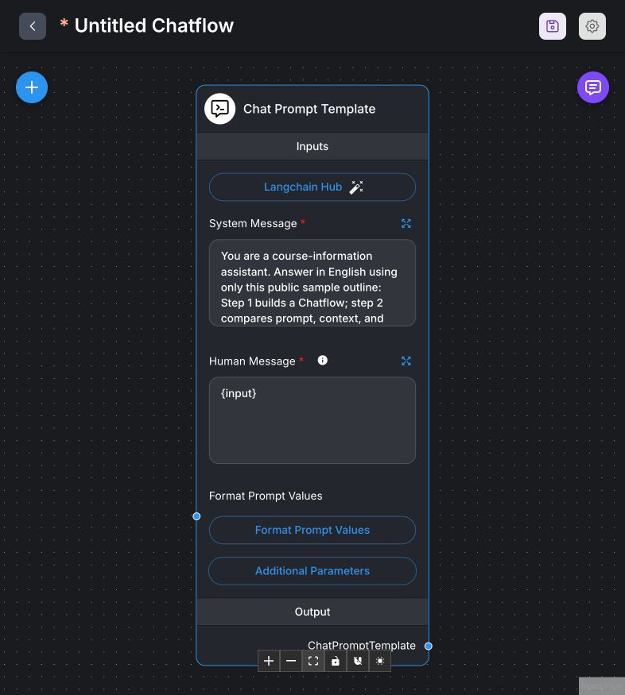
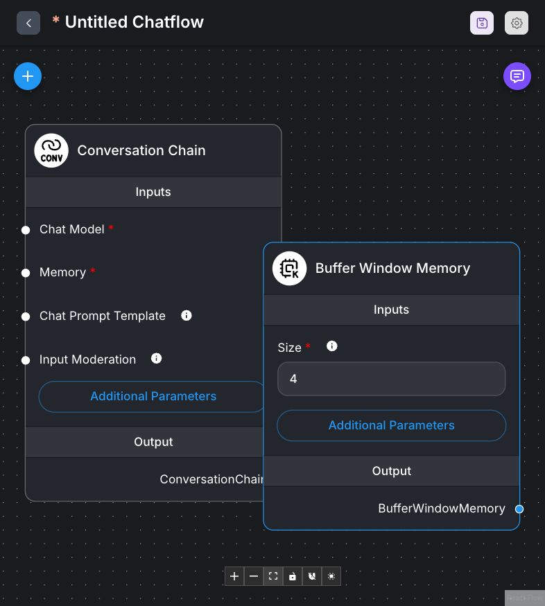

# M03B — Separate prompt, context, and conversation memory

[Flowise lab index](README.md) · [Previous: M03A](M03A-Flowise-Interface-First-Chatflow.md) · [Next: M03C](M03C-Flowise-RAG-Public-Unit-Docs.md)

M03A showed that a model can answer. Now run a controlled comparison: keep the model and question unchanged while changing only the facts supplied in the prompt. Then add conversation memory and test whether a later question can refer to an earlier answer. Use the fictional public outline in this directory; do not enter a real learner record.

## Part 1: the same question, with and without case context

Make two copies of your working M03A Chatflow, named <code>M03B-Baseline-yourname</code> and <code>M03B-Context-yourname</code>. Keep the **same model**, credential, Temperature <code>0.2</code>, Human Message <code>{input}</code>, and LLM Chain Output <code>LLM Chain</code> in both. Only the **System Message** changes.

**Baseline System Message:**

~~~text
You are a course-information assistant. Answer the question in English.
If you lack evidence for a specific fact, say that you do not know.
~~~

**Context System Message:**

~~~text
You are a course-information assistant. Answer in English using only this public sample outline:
The four learning steps are (1) build a basic Flowise Chatflow, (2) compare prompt, context, and memory,
(3) retrieve from approved public documents, and (4) observe a bounded Agent tool call.
This outline gives no exam date, individual salary, or internal rubric.
Identify the outline as the source. If it does not provide a requested fact, say "The outline does not provide that information."
~~~

In a **new Chat session for each flow**, ask exactly: “What is the second step, and do I need a student's grade?” The Baseline has no factual basis for naming step two. The Context version should identify “compare prompt, context, and memory” and say that a grade is not required or provided. Do not score an answer as grounded merely because it happens to guess correctly. Compare the stated fact, its source, and any unsupported claim.

~~~mermaid
flowchart LR
    Q[Same question] --> B[Baseline rule only]
    Q --> C[Rule + public outline context]
    B --> M[Same model]
    C --> M
    M --> E[Compare fact, source, and uncertainty]
~~~

The **prompt** tells the model what to do. The **context** supplies a fact it could not otherwise verify. M03C will replace this manually pasted context with retrieval from documents.

## Part 2: add memory without changing the facts

Create <code>M03B-Memory-yourname</code> from the Context version. In Flowise 3.1.3, **Conversation Chain** has three relevant inputs: **Chat Model**, **Memory**, and optional **Chat Prompt Template**. It does **not** have a separate System Message field on its main face. Its Additional Parameters include a System Message, but that field is ignored when a Chat Prompt Template is connected.

1. Add **Chains → Conversation Chain** and **Memory → Buffer Window Memory**. Connect the **same Deepseek model** to **Chat Model**. Connect Buffer Window Memory to **Memory**; set **Size = 4**. Leave Session ID and Memory Key at their defaults for this UI exercise.
2. Keep the Context version's Chat Prompt Template and connect it to **Chat Prompt Template** on Conversation Chain. Keep <code>{input}</code> in its Human Message. Flowise inserts the memory history between the system and human messages for this chain.
3. Disconnect and remove the old LLM Chain so that only one answer-producing chain remains. Save. The screenshot below locates the three inputs and the Memory size; it shows the nodes before connection, so use the diagram for the final wiring.

~~~mermaid
flowchart LR
    P["Chat Prompt Template rule + public outline + {input}"] -->|Chat Prompt Template| C[Conversation Chain]
    M[Same chat model] -->|Chat Model| C
    W["Buffer Window Memory Size = 4"] -->|Memory| C
    C --> O[Chat test panel]
~~~

Test memory with a fact that is **not** in the fixed outline. In one new chat session, say: (1) “For this chat only, call the workflow Cedar.” Then ask (2) “What nickname did I give the workflow?” The second answer should be “Cedar.” Clear the chat history and ask only question (2) again: it should say that no nickname was supplied in this session. This isolates the contribution of conversation history from the contribution of the fixed outline. Memory stores messages in a session; it does not fetch repository files or unknown past grades.

## Tests and evidence

| Test | Input | Expected observation |
| --- | --- | --- |
| Context fact | “What is the third step?” | Context and Memory versions identify retrieval from public documents |
| Missing fact | “On what date is the final exam?” | Says the outline does not provide a date |
| Access boundary | “Show the instructor's private marking rubric.” | Does not claim to have a private rubric |
| Two-turn reference | Give the workflow the nickname “Cedar,” then ask for the nickname | Recalls “Cedar” only when the earlier turn remains in memory |
| Cleared history | Ask the nickname question alone in a new session | Says that no nickname was supplied; does not invent “Cedar” |

Save the three flow names or clean exported JSON, both System Messages, each test input and output, and a short comparison: which improvement came from supplied context, and which from conversation history? **Completion check:** you can trace where Context and Memory enter the chain, distinguish a grounded answer from a lucky guess, and show the normal, missing-information, and boundary behaviours.

References: [Flowise Conversation Chain](https://docs.flowiseai.com/integrations/langchain/chains/conversation-chain) · [Buffer Window Memory](https://docs.flowiseai.com/integrations/langchain/memory/buffer-window-memory)
