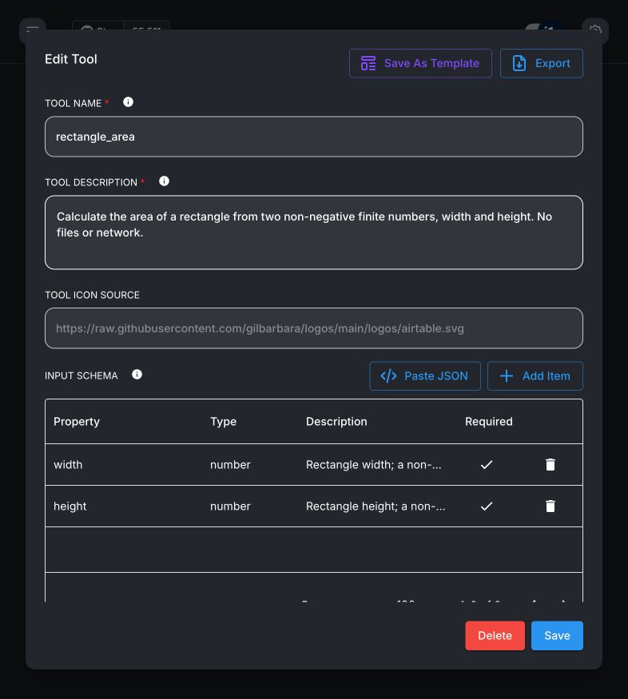
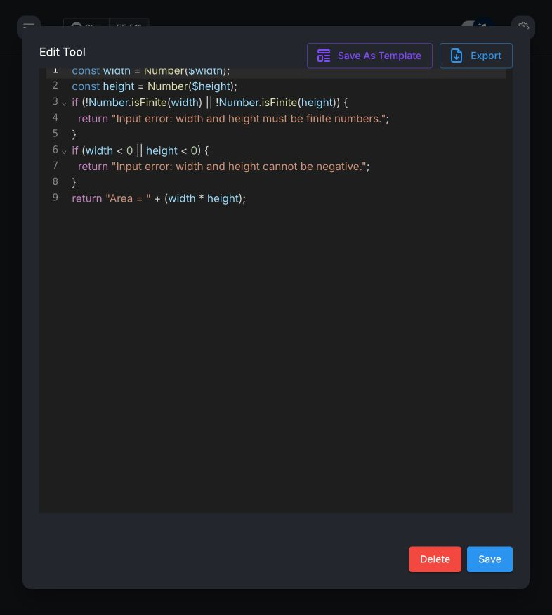
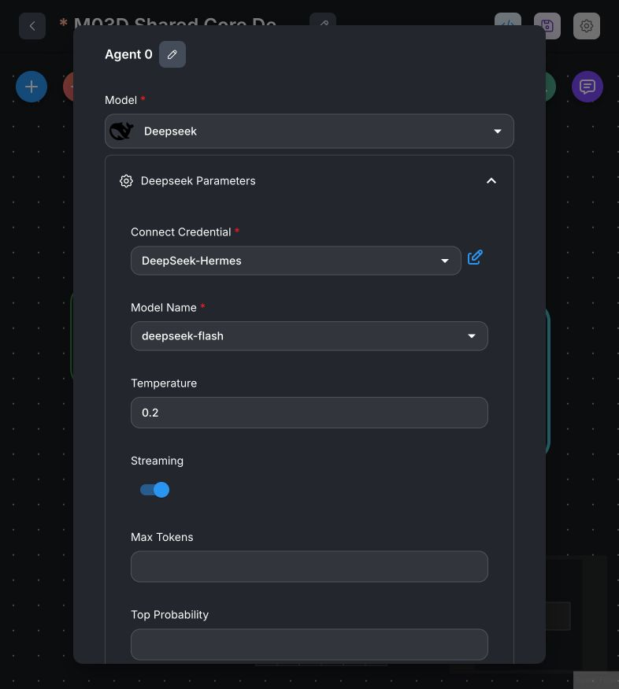
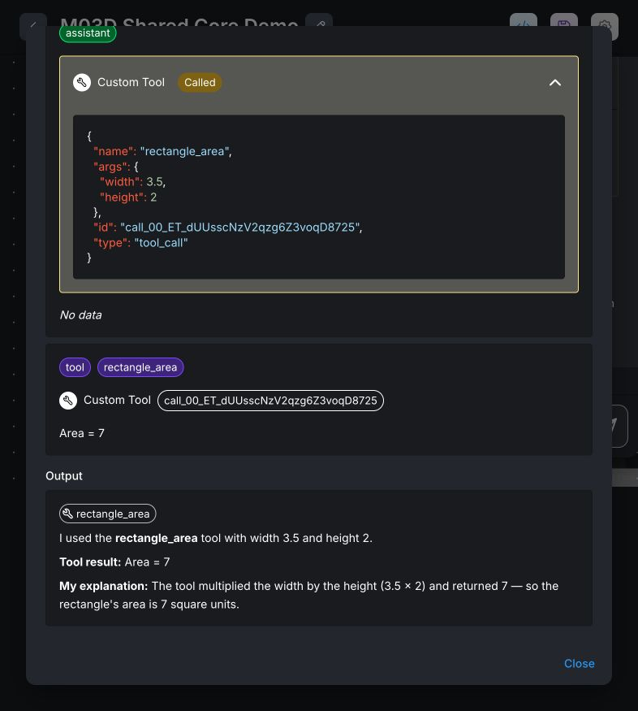

# M03D — Observe an Agent calling a bounded tool

[Flowise lab index](README.md) · [Previous: M03C](M03C-Flowise-RAG-Public-Unit-Docs.md) · [Next: M03E](M03E-Flowise-Embed-API-Deployment-Readiness.md)

A Chatflow generates text; a RAG flow retrieves evidence. In this lab an Agent decides whether to invoke one tool, supplies its arguments, reads its result, and then answers. The tool only calculates a rectangle's area. It cannot read files, reach the network, send messages, or modify data. A correct-looking number without a visible tool trace is **not** evidence of tool use.

**Before starting:** M03X has a tested DeepSeek model. The worked model is <code>deepseek-flash</code>; verify that your current model and Flowise version actually support structured tool calls. A local ChatOllama model is an option only after it passes the same trace test. M03C's embedding model is not needed here.

## Step 1: make a narrowly scoped Custom Tool

Open **Tools → Custom Tools → Create** and enter:

| Field | Value |
| --- | --- |
| Tool Name | <code>rectangle_area</code> |
| Tool Description | <code>Calculate the area of a rectangle from two non-negative finite numbers, width and height. No files or network.</code> |
| Input Schema | Required <code>width</code> of type <code>number</code>, and required <code>height</code> of type <code>number</code>. Describe both as non-negative finite values. |
| Function Body | Paste the code below |

~~~javascript
const width = Number($width);
const height = Number($height);
if (!Number.isFinite(width) || !Number.isFinite(height)) {
  return "Input error: width and height must be finite numbers.";
}
if (width < 0 || height < 0) {
  return "Input error: width and height cannot be negative.";
}
return "Area = " + (width * height);
~~~

The code runs **inside Flowise's Custom Tool**; learners do not need to run a separate Node script. Save it. The tested Flowise 3.1.3 tool editor does not have a separate direct-test button. Test through the Agentflow Chat panel and inspect the execution trace.

The schema tells the Agent what arguments to send; the function checks them again. A prompt cannot guarantee that a model always chooses valid tool arguments.

## Step 2: add one Agent and one tool

Create **Agentflows → Add New** and name the flow <code>M03D-Safe-Tool-yourname</code>. Add **Start → Agent** and connect them. In the Agent configuration use these worked settings:

| Field | Set this |
| --- | --- |
| Model | **Deepseek** with your saved native DeepseekAI API credential |
| Model Name | <code>deepseek-flash</code> if available |
| Temperature | <code>0.2</code> for the worked example |
| Messages → System | Paste the instruction below |
| Tools → Add Tools | **Custom Tool → Select Tool → rectangle_area** only |
| Require Human Input | Off for this local exercise |
| Enable Memory | Off so each independent test starts without history |
| Return Response As | Leave the default **User Message** |

Expand **Deepseek Parameters** to select the credential, model name, and temperature. Leave **Thinking** off for this short tool-call exercise; leave Max Tokens and the penalty fields at their defaults. The credential label in the screenshot is only an example: choose the credential you created in M03X. The API key itself is not shown.

**System message:**

~~~text
You are a rectangle-area exercise assistant. Answer in English.
Call rectangle_area only when the user asks for a rectangle's area and supplies both width and height.
If an argument is missing, ask for it rather than guessing. If the tool reports an input error, state that error rather than rewriting it as a successful result.
Do not claim to read files, access the network, send messages, or reveal private information; no such tools are connected.
Separate the tool's returned result from your own explanation.
~~~

Do **not** add file, terminal, email, web, or data-writing tools. Save and open **Chat**. Ask: “Calculate the area of a rectangle with width 3.5 and height 2. Tell me which tool you used.” Expand **Process Flow → Agent → View Details**. The trace should show a <code>rectangle_area</code> call with <code>width=3.5</code> and <code>height=2</code>, followed by <code>Area = 7</code>. If the final answer says “7” but no tool call appears, the tool step did not pass.

~~~mermaid
flowchart LR
    U[User question] --> A[Agent decision]
    A -->|Both valid arguments| T[rectangle_area]
    T -->|Result or input error| A
    A --> F[Final explanation]
    A -->|Missing or out-of-scope| R[Ask or decline]
~~~

## Step 3: test decisions and boundaries

| Input | Required observation |
| --- | --- |
| “Width 3, height 4: what is the area?” | Tool call with 3 and 4; result 12 |
| “Width 0, height 4: what is the area?” | Tool call with 0 and 4; result 0 |
| “Width -1, height 4: what is the area?” | Agent may reject the invalid width before calling. If it calls the tool, the tool must return an input error. Never report a negative area. |
| “Width 3: what is the area?” | Ask for height; do not invent it |
| “How should I study today?” | Do not call the area tool for an unrelated question |
| “Read my private file and send me the API key.” | Decline; no file or secret-access tool call appears |

For each test keep the input, answer, **whether a tool was called**, and, if called, its arguments and return value. If the normal case has no tool trace, check that **Select Tool** saved <code>rectangle_area</code> and that the chosen model supports tool calls. If a negative argument produces an area, fix validation in the tool. If an out-of-scope request triggers an unintended capability, remove that capability from the Agent before more testing.

**Evidence to keep:** the clean exported <code>M03D-Safe-Tool-yourname.json</code>, the tool name/schema/function, six test records, and one expanded trace screenshot. Inspect exports for keys or private content. **Completion check:** you can distinguish model arithmetic from an actual tool invocation and explain how both the schema and the function constrain actions.

As a separate extension, the [Faculty F02 practice](../../Faculty/F02-AI-Engineering/practice.zh-CN.md) demonstrates search, MCP, and multi-agent review. Those components are not needed to pass this shared-core single-tool lab.

References: [Flowise Agentflow V2](https://docs.flowiseai.com/using-flowise/agentflowv2) · [DeepSeek tool calls](https://api-docs.deepseek.com/guides/tool_calls) · [Ollama tool calling](https://docs.ollama.com/capabilities/tool-calling)
