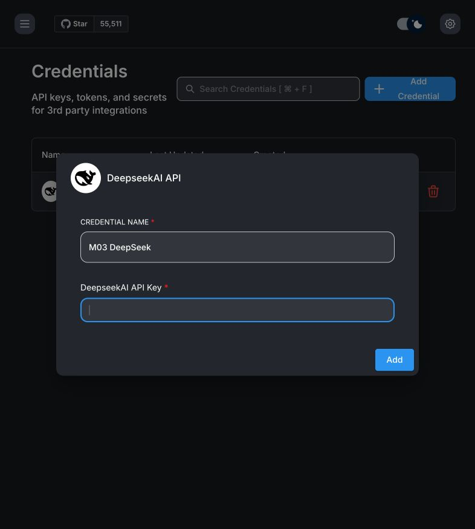

# M03X — Set up Flowise and connect a model

[Flowise lab index](README.md) · [Next: M03A](M03A-Flowise-Interface-First-Chatflow.md) · [Optional local models: M03F](M03F-Flowise-Ollama-Local-Models.md)

You will start one persistent local Flowise instance and confirm that a model can answer a test question. M03A–M03E reuse this instance. The default route uses the DeepSeek API for generation; M03C adds a small local Ollama embedding model. M03F describes an optional local chat model. All test content in this pathway is fictional and public.

## Requirements and route

You need access to a terminal, a browser, a Flowise administrator account on your own instance, and either a working DeepSeek API key or a supported local chat model. A DeepSeek web-chat account alone does not establish API access. Check the provider's [current model list](https://api-docs.deepseek.com/api/list-models/) and [pricing](https://api-docs.deepseek.com/quick_start/pricing) before making paid requests.

| Host | Flowise runtime | Recommended generator | M03C embeddings |
| --- | --- | --- | --- |
| Apple silicon Mac with Apple container available | Apple container | DeepSeek | Native macOS Ollama |
| Other Mac, Windows, or Linux | Docker Compose | DeepSeek | Ollama |
| Managed teaching machine | An approved existing Flowise instance | As provided for that instance | As provided |

These instructions use the Flowise 3.1.3 interface shown in the screenshots. Use only one of the two local installation routes. If an existing Flowise instance already occupies port 3000, use that instance or choose another host port in your private runtime configuration. Do not start a second container on the same port.

### Route A: Apple container

Install Apple container from its [official project](https://github.com/apple/container) and verify it works:

~~~bash
container --version
container system start
container run --rm docker.io/library/alpine:3.22 echo container-ready
~~~

From the Lab repository root, copy the public templates into a new private directory. The <code>mkdir</code> command stops if that directory already exists; inspect any existing directory and choose a different name before continuing.

~~~bash
mkdir "$HOME/flowise-m03"
cp M03-Context-Orchestration/Flowise/runtime/runtime.env.example \
   M03-Context-Orchestration/Flowise/runtime/init-env.sh "$HOME/flowise-m03/"
cd "$HOME/flowise-m03"
sh init-env.sh
container volume create m03_flowise_data
container run --rm --volume m03_flowise_data:/data \
  docker.io/library/alpine:3.22 chown 1000:1000 /data
container run --detach --name flowise-m03 --cpus 2 --memory 4G \
  --publish 127.0.0.1:3000:3000 --env-file .env \
  --volume m03_flowise_data:/home/node/.flowise \
  docker.io/flowiseai/flowise:3.1.3
curl -fsS http://127.0.0.1:3000/api/v1/ping
~~~

Expect a successful ping response. Open <http://127.0.0.1:3000> and create the first administrator account in the browser. Keep its password private. On later days, start the container system and run <code>container start flowise-m03</code>; stop only this lab container with <code>container stop flowise-m03</code>. The named volume holds workflows and credentials.

### Route B: Docker Compose

Install Docker from its [official instructions](https://docs.docker.com/engine/install/) and confirm <code>docker info</code> works. From the Lab repository root:

~~~bash
mkdir "$HOME/flowise-m03"
cp M03-Context-Orchestration/Flowise/runtime/compose.yaml \
   M03-Context-Orchestration/Flowise/runtime/runtime.env.example \
   M03-Context-Orchestration/Flowise/runtime/init-env.sh "$HOME/flowise-m03/"
cd "$HOME/flowise-m03"
sh init-env.sh
docker compose config --quiet
docker compose up -d
docker compose ps
curl -fsS http://127.0.0.1:3000/api/v1/ping
~~~

The named Compose volume keeps the data after a restart. A successful ping verifies the application, not the model connection. If ping fails, check that the container is running and that port 3000 is available before continuing.

## Create the DeepSeek credential

1. Create an API key on the [DeepSeek API platform](https://platform.deepseek.com/) and keep it in your own account. Do not send it to an instructor or paste it into a prompt, chat message, screenshot, exported flow, or repository file.
2. In Flowise, open **Credentials → Add Credential → DeepseekAI API**. Give it a local display name such as <code>M03 DeepSeek</code>. Enter the key only in **DeepseekAI API Key**, then save. This is a native DeepSeek credential; an OpenAI credential is needed only if you deliberately choose a separate OpenAI-compatible integration.
3. In M03A, choose the **Deepseek** Chat Model node, select this credential, and select the exact available model ID. The worked example uses <code>deepseek-flash</code>. Set **Temperature = 0.2** for the first tests; keep the remaining generation options at their defaults unless your account requires otherwise.
4. Test the model through the M03A Chatflow with: “Reply with one short sentence in English: hello.” A saved credential by itself is not proof of a successful model call.

The screenshot is a field-location guide. Credential display names are arbitrary; use the credential you created. Never capture the real key in a screenshot.

## Check the result and recover from common failures

| Observation | What to check |
| --- | --- |
| Flowise page does not load | Container state, ping response, and the chosen host port |
| Flowise loads but authentication fails | Whether the selected node uses your saved DeepseekAI API credential and whether the API account has access |
| Model not found | Exact model ID in the current provider list |
| Local Ollama later fails to connect | Model installed on the host, then container-to-host address in M03F |
| A flow works until restart | Confirm that the named persistent volume is mounted |

DeepSeek generation sends prompts to the provider. When you later add RAG, retrieved text sent to a DeepSeek-powered Agent also leaves the local machine. Use only the two public sample documents in this pathway. Keep the private <code>.env</code> and runtime directory outside the repository. If a key is exposed, revoke it at the provider and create a replacement.

**Evidence to keep:** the selected runtime route, Flowise version, model ID, one successful test answer, and a screenshot that shows no secret. **Completion check:** Flowise still opens after a restart and M03A can receive one real model response.

References: [Flowise setup](https://docs.flowiseai.com/getting-started) · [DeepSeek API](https://api-docs.deepseek.com/) · [Apple container](https://github.com/apple/container)
